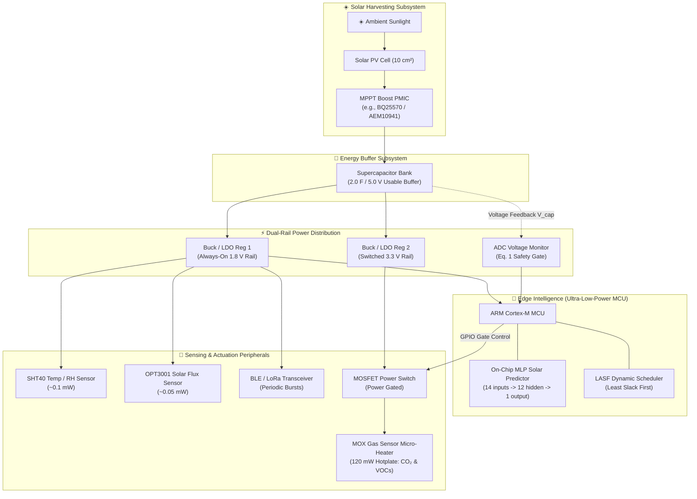
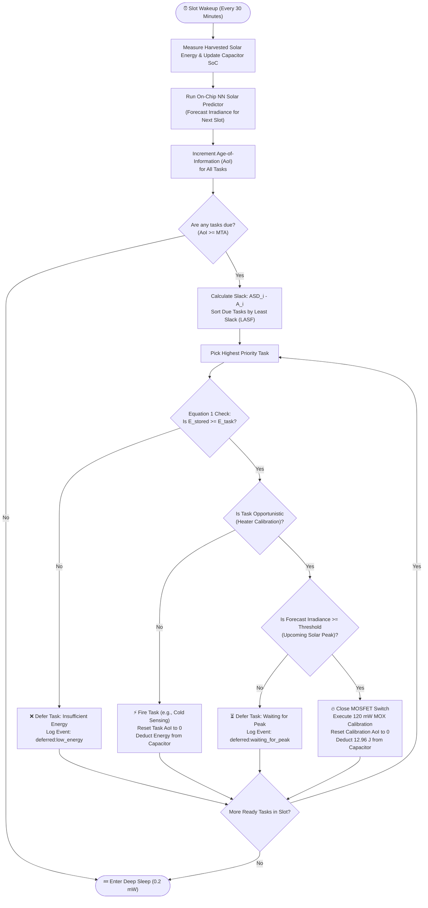

# ☀️ HelioSense — Batteryless Environmental Sensor Node Simulation

[](https://www.python.org/)
[](https://heliosense.streamlit.app/)
[](LICENSE)
[-success.svg)](#pre-charge-assurance)
[](#on-chip-neural-network-predictor)

> **An end-to-end physical simulation of a perpetual, battery-free environmental air quality sensor node ($CO_2$, VOCs) powered exclusively by ambient solar harvesting, featuring on-chip neural weather forecasting, mathematical pre-charge guarantees, and Age-of-Information (LASF) scheduling.**
> 
> 🌐 **Try the Live Simulation:** [https://heliosense.streamlit.app/](https://heliosense.streamlit.app/)

---

## 📌 Executive Summary

Traditional batteryless IoT devices suffer from frequent brownout crashes when executing power-intensive operations—such as heating a metal-oxide (MOX) gas sensor ($120\text{ mW}$) from a tiny supercapacitor. Running these high-power jobs on fixed timers invariably crashes the device during cloudy or nighttime periods.

This project simulates a **predictive, energy-orchestrated architecture** that overcomes the **240× peak-to-average power paradox**:
1. **Tiny On-Chip Neural Network:** Predicts incoming solar irradiance $30\text{ minutes}$ ahead using intra-day and diurnal historical features.
2. **Mathematical Pre-Charge Assurance:** Deterministically verifies that stored energy covers the entire task demand before closing the power switch ($E_{\text{stored}} \ge E_{\text{task}}$), guaranteeing **zero brownout crashes**.
3. **Opportunistic LASF Scheduling:** Prioritizes low-power environmental monitoring and defers heavy thermal recalibration cycles to forecasted solar peaks, eliminating sensor drift without depleting stored reserves.

---

## 🏛️ System Architecture

### Hardware & Power Distribution Block Diagram



---

## 🔄 Decision Logic & Task Scheduling Flowchart

The system runs a **discrete-time scheduling loop** ($T_{\text{adapt}} = 30\text{ mins}$) arbitrating between lightweight continuous sensing and heavy thermal calibration:



---

## 🔬 Sensor Suite & Subsystem Specifications

| # | Sensor Subsystem | Model / Type | Target Parameters | Power Profile | Placement & Role |
| :---: | :--- | :--- | :--- | :--- | :--- |
| **1** | **MOX Gas Sensor** | SGP40 / BME688 | $CO_2$ equiv, TVOCs | **$120\text{ mW}$ Heater**<br>$5\text{ mW}$ Cold Read | Exposed to ambient airflow; micro-hotplate burns off surface drift and restores baseline accuracy. |
| **2** | **Temp & Humidity** | SHT40 / SHTC3 | Temperature, $\% \text{RH}$ | **$< 0.10\text{ mW}$** | Isolated in airflow channel; dynamic cross-sensitivity compensation for humidity-dependent gas resistance. |
| **3** | **Solar Light / Flux** | OPT3001 / Photodiode | Irradiance ($W/m^2$), Lux | **$< 0.05\text{ mW}$** | Top surface co-located with PV cell; samples 30-min solar irradiance inputs for the neural predictor. |
| **4** | **Capacitor Monitor** | Internal MCU ADC | Voltage $V_{\text{cap}}$ ($2.2\text{V} - 5.0\text{V}$) | **$< 0.01\text{ mW}$** | Direct Kelvin-sensing connection across supercapacitor terminals to enforce Equation 1 safety gating. |
| **5** | **Radio Transceiver** | BLE / Sub-GHz LoRa | Telemetry & Alerts | **$\sim 30\text{ mW}$ (TX burst)** | Architecture-ready uplink for aggregated environmental and node health metrics. |

---

## ⚡ The Peak-to-Average Power Paradox

$$\text{Peak-to-Average Ratio} = \frac{\text{Peak Heater Power (120 mW)}}{\text{Average Continuous Draw (0.5 mW)}} = \mathbf{240\times}$$

* **Continuous Average Budget:** $\approx 0.45 - 0.55\text{ mW}$ (MCU deep sleep at $0.2\text{ mW}$, intermittent sensing at $5\text{ mW}$, and amortized daily calibration).
* **Instantaneous Heater Pulse:** **$120\text{ mW}$ for $1.8\text{ minutes}$** ($12.96\text{ Joules}$).
* **Why Fixed Timers Fail:** If a fixed $24\text{h}$ timer triggers the heater during cloud cover or twilight, the supercapacitor discharges past $V_{\text{min}}$ ($2.2\text{V}$), plunging the node into an unrecoverable **brownout reboot**.

---

## 📐 Mathematical Formulation

### 1. Supercapacitor Usable Energy Buffer
The usable energy $E_{\text{usable}}$ stored between operational maximum $V_{\text{max}}$ and brownout cutoff $V_{\text{min}}$:
$$E_{\text{usable}} = \frac{1}{2} C \left(V_{\text{max}}^2 - V_{\text{min}}^2\right)$$
For $C = 2.0\text{ F}$, $V_{\text{max}} = 5.0\text{ V}$, and $V_{\text{min}} = 2.2\text{ V}$:
$$E_{\text{usable}} = \frac{1}{2} (2.0) \left(5.0^2 - 2.2^2\right) = 25.0 - 4.84 = \mathbf{20.16\text{ Joules}}$$

### 2. Pre-Charge Assurance Check (Equation 1)
Before actuating any high-power task $i$, the controller evaluates:
$$E_{\text{stored}}(t) \ge E_{\text{need}, i} + E_{\text{margin}}$$
where $E_{\text{need}, i} = P_i \times D_i$. For the MOX heater ($120\text{ mW} \times 108\text{ s} = 12.96\text{ J}$), execution is strictly prohibited unless $E_{\text{stored}} \ge 12.96\text{ J}$.

### 3. Least-Age-of-Information-Slack-First (LASF) Scheduling
Dynamic slack $S_i(t)$ represents the urgency before data freshness expires:
$$S_i(t) = \text{ASD}_i - A_i(t)$$
$$\text{ASD}_i = U_l \cdot \text{MTA}_i - C_i$$
* $A_i(t)$: Current Age of Information (elapsed time since last execution).
* $\text{MTA}_i$: Maximum Tolerable Age of Information.
* $C_i$: Worst-case execution duration.
* $U_l$: Utilization bound factor.
Lower slack translates to higher dispatch priority among due tasks.

### 4. On-Chip Neural Network Predictor (TinyML)
* **Architecture:** Multi-Layer Perceptron (14 inputs $\to$ 12 ReLU hidden units $\to$ 1 linear output).
* **Input Feature Vector $\mathbf{x}_t \in \mathbb{R}^{14}$:**
  $$\mathbf{x}_t = \left[ I_{t-10}, I_{t-9}, \dots, I_{t-1}, I_{t}^{\text{day}-1}, I_{t}^{\text{day}-2}, I_{t}^{\text{day}-3}, I_{t}^{\text{day}-4} \right]$$
  Combining **immediate 5-hour weather trends** with **diurnal historical cycles**.

---

## 🧪 Environmental Test Scenarios

The simulator includes **6 built-in deployment presets** accessible with 1 click:

| Preset Scenario | Solar Flux ($W/m^2$) | Cloud Variability | Capacitor | Benchmark Focus |
| :--- | :---: | :---: | :---: | :--- |
| **☀️ 1. High-Desert** | $1100$ | $0.05$ (Clear) | $2.0\text{ F}$ | Ultra-fast solar charging (~2.1h to full); nominal noon calibration. |
| **⛈️ 2. Monsoon Storms** | $750$ | $0.85$ (Violent) | $0.8\text{ F}$ | **Stress Test:** Naive timer crashes 4–7 times; adaptive design maintains **0 brownouts**. |
| **❄️ 3. Nordic Winter** | $420$ | $0.30$ (Diffused) | $2.2\text{ F}$ | Extreme energy scarcity; LASF preserves sensing while deferring calibration safely. |
| **🏙️ 4. Urban Canyon** | $750$ | $0.60$ (Step-like) | $1.5\text{ F}$ | Tests neural memory against sharp, recurring morning & evening building shadows. |
| **🌱 5. Greenhouse** | $950$ | $0.20$ (Humid) | $3.0\text{ F}$ | High duty-cycle calibration (every 12h) under aggressive $140\text{ mW}$ load. |
| **🪟 6. Indoor Window** | $280$ | $0.15$ (Low light) | $2.0\text{ F}$ | Sub-milliwatt micro-harvesting survival with throttled actuation. |

---

## 📊 Performance Comparison: Our Design vs. Naive Baseline

| Metric | Traditional Fixed-Timer | Adaptive Predictive Architecture (This Work) |
| :--- | :---: | :---: |
| **Brownout Crashes (Storms)** | **4 to 7 Crashes** | **0 Crashes (Mathematically Guaranteed)** |
| **Heater Activation Policy** | Blind Periodic Clock ($24\text{h}$) | Opportunistic Peak-Forecast Gating |
| **Energy Awareness** | None (Executes regardless of SoC) | Closed-Loop Pre-Charge Verification (Eq. 1) |
| **Task Prioritization** | FIFO / Static Priority | Least-Age-of-Information-Slack-First (LASF) |
| **Predictor Engine** | None / Static EWMA | 14-Input Diurnal-Trend Neural Network |
| **Sensor Measurement Drift** | Prone to complete outage resets | Stable, Continuous Baseline Correction |

---

## 🚀 Installation & Quickstart

### Prerequisites
* Python 3.10, 3.11, 3.12, or 3.13
* Git

### 1. Clone the Repository
```bash
git clone https://github.com/sathyaseelan2006/Batteryless-Environmental-Sensor-Simulation.git
cd Batteryless-Environmental-Sensor-Simulation
```

### 2. Install Dependencies
```bash
pip install -r requirements.txt
```

### 3. Launch the Streamlit Simulation App
```bash
streamlit run app.py
```
Open your browser at **`http://localhost:8501`** (or port specified in terminal).

---

## 📂 Repository Structure

```
Batteryless-Environmental-Sensor-Simulation/
├── app.py                         # Interactive Streamlit dashboard & analytics UI
├── sensor_sim.py                  # Standalone physical simulation engine & TinyML model
├── requirements.txt               # Project dependencies (streamlit, scikit-learn, plotly, etc.)
├── architecture_reference.png     # High-resolution hardware architecture schematic
├── batteryless_node_3d.html       # Embedded interactive 3D digital-twin visualizer
├── batteryless_simulation.js      # Simulation-to-3D bridge script
├── solar_panel_fbx.glb            # 3D glTF model of harvesting hardware
├── BatterylessNodeUnity/           # Unity 3D demonstration project & scripts
│   ├── Assets/                    # Unity C# controller & orbit scripts
│   ├── Packages/                  # Unity package manifest
│   └── ProjectSettings/           # Unity version configuration
└── README.md                      # Comprehensive project documentation
```

---

## 📜 Citation & Attribution

If you utilize this simulation engine, scheduling formulations, or architecture models in academic research or patent references, please cite:

```bibtex
@misc{batteryless_sensor_sim_2026,
  author = {Sathyaseelan, K.},
  title = {Adaptive Predictive Energy-Orchestrated Batteryless Environmental Sensor Node Simulation},
  year = {2026},
  publisher = {GitHub},
  howpublished = {\url{https://github.com/sathyaseelan2006/Batteryless-Environmental-Sensor-Simulation}}
}
```

---

## 📄 License
This project is open-source under the [MIT License](LICENSE).
